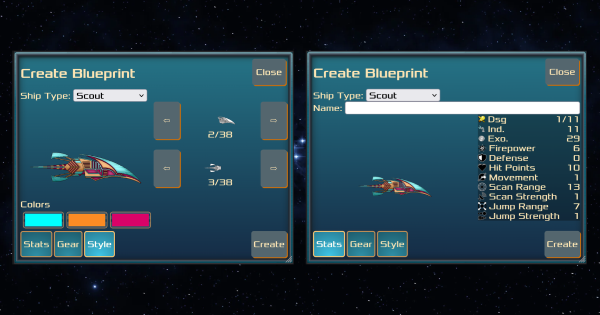
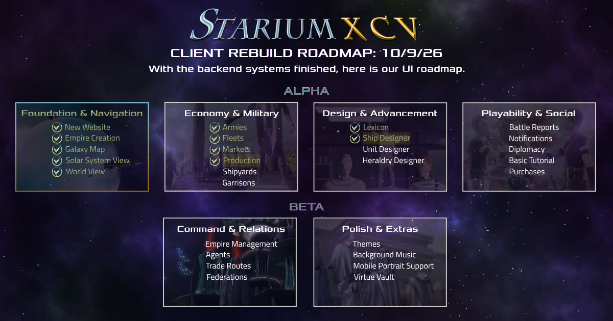

We have a Ship Designer, moved production math to the client, and changed our milestones so players can get into the game sooner. Here's the rundown this month.

#### The Ship Designer

Our Ship Designer is here! It needs a bit of polish, but it’s fully functioning. This is where you'll build your ships and decide how they're equipped.

#### Production Math

Production math was a big pain point in our old client. Doing all of that math on the server was resource intensive and laggy. Moving it to the client gives the player a better experience, and it gives us more room to show you the production and resource numbers.

#### Getting You Playing

We've changed our milestones. Our first public release is now an alpha instead of a beta.

We're a couple of months out from making the game publicly playable, so everything we build right now is aimed at one thing: getting you playing. Working through it has made it clearer what really matters to the core gameplay, and we feel good about letting you play with fewer features than we first planned. The rest will come after.

#### What's Next

- Shipyards
- Garrisons
- Unit Designer

**_Thank You For Supporting StariumXCV_**

We'd love to get to know you, and we invite you to join our community on <a href="https://discord.com/invite/4aVHaRadPC" target="_blank">Discord</a>. Our devs are always around and happy to chat, whether you have questions, feedback, or just want to say hi!