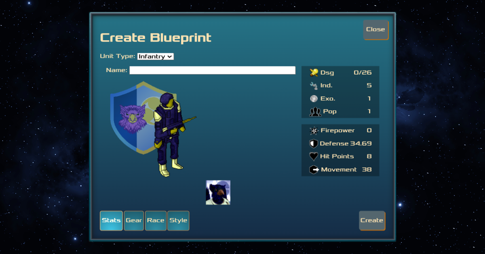
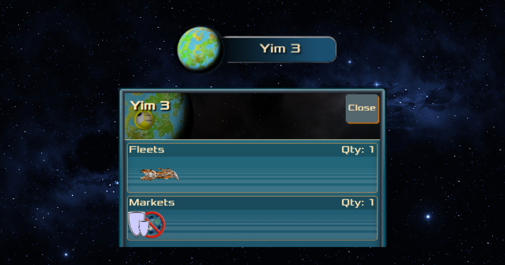
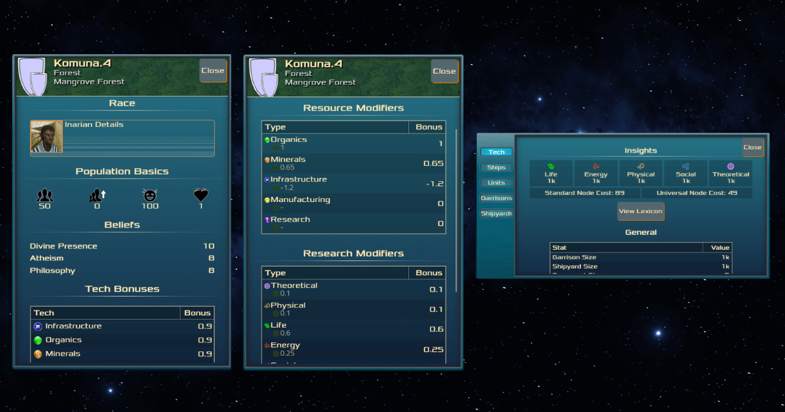
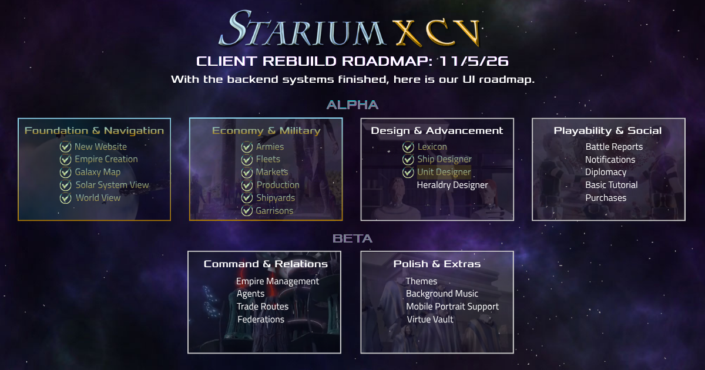

We’re closing out our core gameplay milestone this month. Most of the work went into finishing the last big pieces and fixing a lot of bugs along the way. Here’s the rundown.

#### The Unit Designer

The Unit Designer is done. Every unit can now have its own insignia, and you can customize them to make your forces your own. We put extra care into the color picker, and we are happy with the overall look.

#### The World Widget

The World Widget now launches the world menu, which shows everything you have in orbit, including your fleets and markets. Gates and wormholes will show up there too when they’re around.

#### Population, Area, Technology

The Population UI and Area Details got their full build, and the Technology UI now lists all of its stats in a cleaner, more readable layout.

This was the last of our placeholder UI. Everything in there used to be a stand-in, and now it’s the real thing.

#### Garrisons & Shipyards

All the code for Garrisons and Shipyards is there and the functionality works. They’re still a little buggy, so we’re working through the final fixes.

#### Small Wins

- Units and ships now appear in full color throughout the interface
- We’re debugging our lexicon and our massive tech tree, there are a lot of nodes to get right, but it’s coming along

#### What's Next

- Payment Integration
- EULA & Credits
- More bug fixes

**_Thank You For Supporting StariumXCV_**

We'd love to get to know you, and we invite you to join our community on <a href="https://discord.com/invite/4aVHaRadPC" target="_blank">Discord</a>. Our devs are always around and happy to chat, whether you have questions, feedback, or just want to say hi!